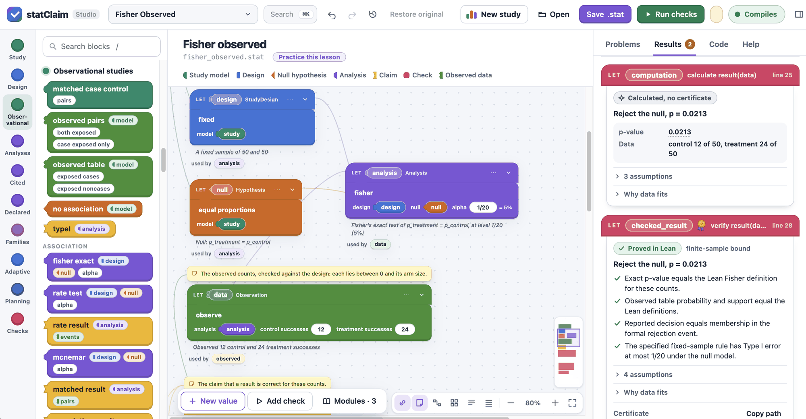
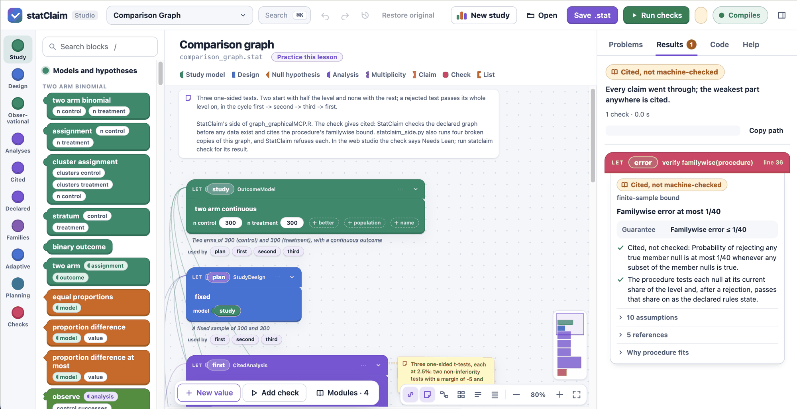

# StatClaim

**Study designs as types, protocols as programs and statistical claims as proof obligations.**

[](https://github.com/ssm123ssm/statClaim/actions/workflows/check.yml)
[](https://codespaces.new/ssm123ssm/statClaim?quickstart=1)
[](https://ssm123ssm.github.io/statClaim/)

StatClaim is a declarative domain-specific language for encoding research
protocols and statistical analysis plans as programs. A program is built from
objects whose types encode their statistical roles within the study design:
models, sampling plans, hypotheses, analyses and claims. The compiler checks
type compatibility and applies contracts that check further requirements on the
values and relationships of these objects, before any outcomes are collected.

When verification is requested, the backend constructs proofs of supported
statistical claims and checks them in [Lean](https://lean-lang.org) under stated
assumptions. Supported claims concern Type I error, familywise error, power and
interval coverage, including combinations of analyses and procedures with
planned stopping rules. Reports distinguish formally proved, conditional, cited
and author-declared guarantees, and verified claims are accompanied by
replayable certificates. The same specification supports sample-size searches,
power calculations and interval-precision assessment by exact calculation,
analytical approximation or reproducible simulation.



*Figure 1. StatClaim Studio with an observed-result claim
([`fisher_observed.stat`](examples/paper/fisher_observed.stat)). The calculation
gives p = 0.0213. The Lean proof establishes that this value equals the p-value
defined by Fisher's exact test for the observed counts, and that the reported
decision follows from it.*

## Motivation

A correctly computed test does not establish that its error guarantee applies
to the study in which it is used. The guarantee depends on the null hypothesis,
the sampling mechanism and the decision rule. Testing several endpoints
separately at the 5% level does not by itself establish a 5% familywise error
bound, and a guarantee for a single analysis at a fixed sample size does not
extend to a procedure that examines accumulating data and stops at
significance. StatClaim records these dependencies explicitly, so that they can
be examined during protocol development.

## Approach

1. **Declaration.** The study is specified as typed objects: a model, a sampling
   plan, hypotheses, analyses and claims.
2. **Compilation.** The compiler checks argument types and applies compatibility
   contracts. An analysis, for example, must support the declared null
   hypothesis and refer to the model to which that hypothesis belongs. A missing
   justification is reported as an unresolved requirement; it does not imply
   that the claim is false.
3. **Verification.** On request, supported claims are proved in Lean, and a
   certificate is issued that can be replayed. Claims outside this scope are
   reported as cited or declared.
4. **Planning.** Sample size, power and precision are assessed from the same
   specification by exact calculation, analytical approximation or simulation
   with reported Monte Carlo uncertainty.

| Evidence grade | Result status | Basis |
| --- | --- | --- |
| Proved | `verified` | A proof checked by Lean |
| Conditional | `conditional` | A combination checked by Lean, conditional on the guarantees of its members |
| Cited | `cited` | A published result whose contract fits the declaration |
| Declared | `declared` | An assertion by the author; only its compatibility with the design is checked |

Calculations and simulations have the statuses `calculated` and `simulated`;
they report numerical results rather than guarantees. The status of a file is
that of its weakest evidence-bearing result.



*Figure 2. A graphical multiple-testing procedure over three tests
([`graph.stat`](replication/comparison/graph.stat)). The declared graph is
checked; the familywise error bound of the procedure is cited from the
literature and reported as such.*

## Example

The following program declares two independent binomial samples of 50, the
null hypothesis of equal proportions and a two-sided Fisher exact test at level
1/20, and requests verification of its Type I error bound. No observations are
required.

```stat
use models.two_arm_binomial
use sampling
use tests.fisher

let study = two_arm_binomial(n_control=50, n_treatment=50)
let design = fixed(model=study)
let null = equal_proportions(model=study)
let analysis = fisher(design=design, null=null, alpha=1/20)

let claim = typeI(analysis)
let verification = verify(claim)
```

`statclaim check study.stat` reports (excerpt):

```text
verified [verification]: typeI(analysis)
  Evidence: proved in Lean; guarantee: finite-sample bound
  The specified two-sided Fisher analysis has Type I error at most 1/20 under the null, for every common success probability in [0, 1].
  Assumptions:
    The samples follow two independent binomial distributions.
    Positive arm sizes were fixed before outcomes were observed.
```

Replacing the sampling plan with `adaptive(model=study)`, which declares
data-dependent stopping without a specified rule, leaves the claim unresolved:

```text
obligation [sampling_scope]: analysis: data-dependent stopping needs a justified sampling law before the fixed-sample guarantee can be used. This is not evidence of inflated error.
```

Both programs are available in the web studio:
[`paper/fisher_design`](https://ssm123ssm.github.io/statClaim/?open=paper/fisher_design) and
[`paper/fisher_adaptive`](https://ssm123ssm.github.io/statClaim/?open=paper/fisher_adaptive).

## Study planning

With `use planning` added to the program above, the following declarations
request the smallest equal allocation that attains 80% power at response rates
of 0.1 and 0.4:

```stat
let alternative = binomial_rates(p_control=1/10, p_treatment=2/5)
let target = power_target(at=alternative, minimum=4/5, maximum_typeI=1/20)
let candidates = equal_arm_sizes(analysis=analysis, min_per_arm=2, max_per_arm=40)
let sizing = verify(smallest_sample_size(candidates=candidates, target=target))
```

The search selects 36 participants per arm. Verification establishes that this
size meets the target and that no smaller size in the declared range does; each
smaller candidate is checked, because the power of a discrete test need not
increase with sample size. Approximate methods report calculated power, and
simulation reports estimates with 95% Clopper–Pearson intervals. See
[study planning](docs/planning.md).

## Supported methods

Methods with guarantees proved in Lean:

| Purpose | Module | Proved in Lean |
| --- | --- | --- |
| Comparison of two proportions | `tests.fisher` | Type I error (two-sided and one-sided), exact p-value and decision |
| Non-inferiority or superiority for a difference in proportions | `tests.difference` | Type I error over the composite null, power and decision |
| Randomisation tests, by participant or cluster, with strata or blocks | `tests.randomisation` | Type I error under the sharp null, for any test statistic |
| Association in cohort, case-control and cross-sectional studies | `tests.association` | Type I error of Fisher's exact test for each design, of McNemar's test for matched pairs and of the exact rate test for person-time data |
| Inference for one proportion | `tests.binomial` | Type I error, exact p-value and decision; coverage of the exact interval |
| Interval estimation for differences, risk and odds ratios and prevalence | `estimation`, `estimation.observational` | Coverage of exact or conservative intervals |
| Multiple endpoints | `multiplicity.bonferroni` | Familywise error for 2 to 20 endpoints |
| Sample-size determination | `planning` | Power at the planning point, and minimality within the declared range |
| Two-stage designs with futility stopping | `designs.two_stage` | Type I error and power of the complete design; decision for observed data |
| Two-stage design search | `designs.two_stage` | Error and power of the selected optimal or minimax design; the ranking is computed numerically |

Methods with cited, conditional or declared guarantees:

| Purpose | Module | Guarantee |
| --- | --- | --- |
| Comparison of two means | `tests.t` | Cited: pooled t-test (exact under normality) or Welch test (large-sample) |
| Comparison of survival curves | `tests.survival` | Cited: log-rank test (large-sample) |
| Repeated measurements | `tests.mixed_model` | Cited: mixed model for repeated measures (large-sample) |
| Cluster-randomised trials | `tests.cluster` | Cited: t-test on cluster means or proportions |
| Covariate adjustment | `tests.logistic`, `tests.regression` | Cited: logistic, conditional logistic, Poisson and linear regression |
| Methods outside the library | `tests.declared` | Declared: compatibility with the design is checked |
| Combination of proved and cited tests | `multiplicity.bonferroni` | Conditional: the combination is checked in Lean; member guarantees are assumed |
| Fixed-sequence testing | `multiplicity.fixed_sequence` | Conditional: the hierarchical rule is checked in Lean |
| Graphical procedures | `multiplicity.graphical` | Cited: the graph is checked; the guarantee of the procedure is cited |
| Planned interim analyses | `designs.group_sequential` | Conditional: the allocation of the error level across analyses is checked in Lean |
| Approximate power and precision | `planning` | Calculated or simulated: numerical results, not verified |

Further detail is given in the [language reference](docs/catalogue.md) and in the
documentation on [cited methods](docs/cited-methods.md),
[observational studies](docs/observational.md) and
[evidence grades](docs/scope.md#evidence-grades).

## Validation

- **Simon's two-stage designs.** The 102 optimal and minimax designs tabulated
  by Simon (1989) meet their stated error and power targets in exact
  arithmetic. A search over designs with at most 120 participants recovers every
  tabulated design, and Lean proofs establish the error and power bounds of
  each. The R package clinfun selects the same designs.
- **A clinical trial analysis plan.** The COPD case study encodes selected
  components of a published statistical analysis plan (NCT03162055): a
  graphical co-primary family (cited), a fixed sequence of secondary endpoints
  (conditional) and four power statements, which are reproduced by calculation.

`make replicate` reproduces the pinned results without Lean in approximately
three minutes; `make replicate-lean` also rebuilds the proofs. See
[replication](replication/README.md).

## Installation and use

- **[Web studio](https://ssm123ssm.github.io/statClaim/).** Requires no
  installation. It compiles programs, explains contracts and runs calculations
  and simulations. Requests that use `verify` require the Lean environment,
  which is not available in a browser.
- **[GitHub Codespaces](https://codespaces.new/ssm123ssm/statClaim?quickstart=1).**
  Provides the complete environment, including Lean. The studio opens in a
  separate tab once setup has finished. Usage is billed to the user's GitHub
  account.
- **Python package.** Compilation, reports, calculations and cited claims
  require only Python:

  ```sh
  pip install statclaim
  ```

- **Local installation with Lean.** Requires
  [uv](https://docs.astral.sh/uv/getting-started/installation/),
  [elan](https://github.com/leanprover/elan#installation) and Node.js 22 or later:

  ```sh
  make setup
  uv run --locked statclaim check examples/fisher.stat
  uv run --locked python studio/server.py   # studio at http://127.0.0.1:4180/
  ```

A tutorial of 45 lessons ([`docs/tutorial.html`](docs/tutorial.html)) covers
declarations, diagnostics, exact and cited methods, composition, planning and
simulation; the corresponding files are in `examples/tutorial/`. The programs
in the StatClaim article are in [`examples/paper/`](examples/paper/README.md).
Each distributed program can be opened in the web studio by name, for example
[`?open=tutorial/07_sample_size`](https://ssm123ssm.github.io/statClaim/?open=tutorial/07_sample_size).
The [quickstart](docs/quickstart.md) describes the command-line interface and
the VS Code extension.

## Scope and limitations

StatClaim is a 0.1 developer preview, and the language may change. A verified
claim holds under its stated assumptions; whether a study satisfies those
assumptions requires scientific judgement. A specification that declares a
fixed analysis cannot establish that the endpoint was chosen before outcomes
were examined. StatClaim does not analyse existing R or Python scripts; it
specifies the design and the guarantees claimed for it. See
[scope and trust](docs/scope.md).

## Documentation and contributing

- [Language reference](docs/catalogue.md): grammar, types, constructors, statuses, limits and diagnostic codes.
- [Architecture](docs/architecture.md): source, compiler, Python execution and Lean.
- [Studio](studio/README.md): the block editor, run locally, in Codespaces or on the web.
- [Contributing](CONTRIBUTING.md) and [adding a module](docs/adding-modules.md).
- [Roadmap](ROADMAP.md): priorities and release criteria.
- [Technical reference](docs/README.md): language, proofs and certificates.

Questions and proposals are handled in
[Discussions](https://github.com/ssm123ssm/statClaim/discussions), and defects
and tasks in [Issues](https://github.com/ssm123ssm/statClaim/issues). Citation
information is given in [CITATION.cff](CITATION.cff). StatClaim is released
under the [MIT license](LICENSE).
